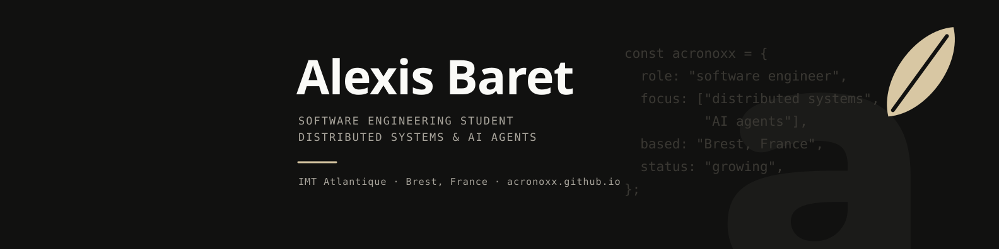

<div align="center">

<picture>
  
</picture>

<br />

Engineering student at **IMT Atlantique**, based in **Brest, France**.<br />
I explore everything between low-level programming, the web, and data.

<br />

<a href="https://acronoxx.github.io"></a>&nbsp;
<a href="https://linkedin.com/in/alexis-baret-4786a3374"></a>&nbsp;
<a href="mailto:alexisbaret05.dev@gmail.com"></a>&nbsp;
<a href="https://ko-fi.com/acronox"></a>

</div>

---

## `> whoami`

```yaml
name: Alexis Baret
alias: Acronox
location: Brest, France
status: Engineering student @ IMT Atlantique

focus:
  - Software engineering
  - Web development
  - Data & infrastructure
  - Learning by building

offline:
  training: "Push / Pull / Legs — 5 sessions per week"
  games: ["The Finals", "Animal Crossing", "Minecraft"]
  fuel: ["Protein shake", "Lo-fi"]
```

## Tech index

<table align="center">
  <tr>
    <td align="center" valign="top" width="50%">
      <h3 align="center">Languages</h3>
      <p>
        
      </p>
      <p>
        
        
      </p>
    </td>
    <td align="center" valign="top" width="50%">
      <h3 align="center">Frameworks & tools</h3>
      <p>
        
      </p>
    </td>
  </tr>
  <tr>
    <td align="center" valign="top" width="50%">
      <h3 align="center">Data & databases</h3>
      <p>
        
      </p>
      <p>
        
        
      </p>
    </td>
    <td align="center" valign="top" width="50%">
      <h3 align="center">Cloud & infrastructure</h3>
      <p>
        
      </p>
      <br />
      <blockquote>
        The stack evolves with every new project.
      </blockquote>
    </td>
  </tr>
</table>

## GitHub activity

<div align="center">
  <picture>
    <source media="(prefers-color-scheme: dark)" srcset="https://github-readme-stats.vercel.app/api?username=acronoxx&show_icons=true&bg_color=111110&title_color=F1EFEA&icon_color=CDB88E&text_color=F1EFEA&border_color=2B2A27&rank_icon=github" />
    
  </picture>
  <picture>
    <source media="(prefers-color-scheme: dark)" srcset="https://github-readme-stats.vercel.app/api/top-langs/?username=acronoxx&layout=compact&bg_color=111110&title_color=F1EFEA&text_color=F1EFEA&border_color=2B2A27&langs_count=8" />
    
  </picture>
</div>

<div align="center">
  <picture>
    <source media="(prefers-color-scheme: dark)" srcset="https://streak-stats.demolab.com?user=acronoxx&background=111110&border=2B2A27&ring=CDB88E&fire=CDB88E&currStreakLabel=CDB88E&sideLabels=F1EFEA&dates=F1EFEA&currStreakNum=F1EFEA&sideNums=F1EFEA" />
    
  </picture>
</div>

## Beyond the code

<picture>
  
</picture>

---

<div align="center">

### Build. Learn. Repeat.

Always open to conversations, new ideas, and interesting projects.


<sub>Built with code, a protein shake, and probably a lo-fi playlist.</sub>

</div>
